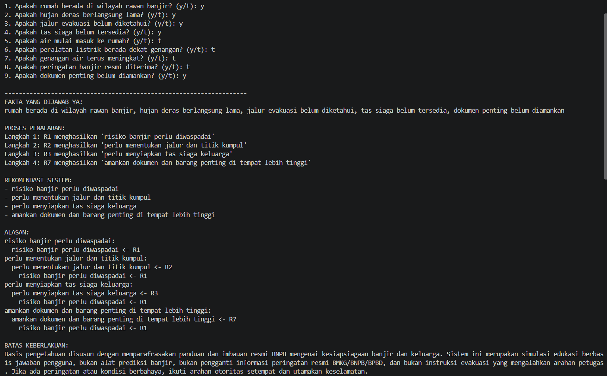
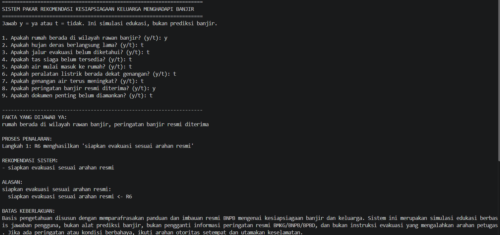
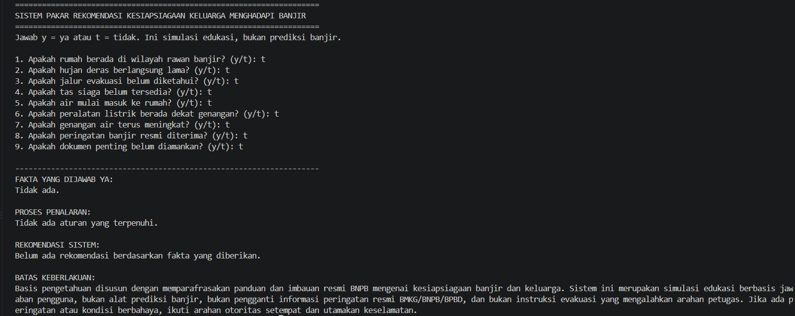

# Sistem Pakar Rekomendasi Kesiapsiagaan Keluarga Menghadapi Banjir

**Nama:** [Muhamad Syahril Qodrul Irpan]  
**NIM:** [F1D02410016]  
**Mata Kuliah:** Kecerdasan Buatan 
## Topik dan Tujuan
Program ini merupakan sistem pakar sederhana untuk memberikan rekomendasi kesiapsiagaan keluarga menghadapi potensi banjir. Pengguna menjawab pertanyaan mengenai kondisi rumah, hujan, perlengkapan darurat, dan informasi peringatan. Program memproses jawaban menggunakan Forward Chaining.

## Cara Menjalankan
- Bahasa: Python 3
- Disarankan: Python 3.9 atau lebih baru
- Library tambahan: tidak ada.

Jalankan melalui terminal pada folder proyek:

```bash
python main.py
```

Jawab pertanyaan dengan `y` (ya) atau `t` (tidak).

## Sumber 

| Kode | Judul | Penerbit | URL | Tanggal akses |
|---|---|---|---|---|
| S1 | Buku Saku Tanggap Tangkas Tangguh Menghadapi Bencana | BNPB | https://bnpb.go.id/storage/app/media/Buku%20BNPB/Buku%20Saku%20Bencana%20BNPB.pdf | 14 November 2026 |
| S2 | BNPB Terbitkan Delapan Langkah Kesiapsiagaan Hadapi Musim Hujan 2026/2027 | BNPB | https://bnpb.go.id/berita/bnpb-terbitkan-delapan-langkah-kesiapsiagaan-hadapi-musim-hujan-2026-2027 | 14 November 2026 |

## Tabel Aturan IF-THEN

| ID | IF (syarat) | Mode | THEN (hasil) | Sumber |
|---|---|---|---|---|
| R1 | Rumah berada di wilayah rawan banjir DAN hujan deras berlangsung lama | AND | Risiko banjir perlu diwaspadai | S1, S2 |
| R2 | Risiko banjir perlu diwaspadai DAN jalur evakuasi belum diketahui | AND | Perlu menentukan jalur dan titik kumpul | S1, S2 |
| R3 | Risiko banjir perlu diwaspadai DAN tas siaga belum tersedia | AND | Perlu menyiapkan tas siaga keluarga | S1, S2 |
| R4 | Air mulai masuk ke rumah DAN peralatan listrik berada dekat genangan | AND | Ada potensi bahaya listrik | S1 |
| R5 | Ada potensi bahaya listrik DAN genangan air terus meningkat | AND | Jauhi area tergenang dan ikuti arahan petugas terkait listrik | S1 |
| R6 | Peringatan banjir resmi diterima DAN rumah berada di wilayah rawan banjir | AND | Siapkan evakuasi sesuai arahan resmi | S1, S2 |
| R7 | Risiko banjir perlu diwaspadai DAN dokumen penting belum diamankan | AND | Amankan dokumen dan barang penting di tempat lebih tinggi | S1 |

R2, R3, dan R7 menggunakan hasil dari R1. R5 menggunakan hasil dari R4. Ini menunjukkan adanya penalaran berantai.

## Metode: Forward Chaining
Forward Chaining dipilih karena proses dimulai dari fakta yang diketahui, yaitu jawaban pengguna. Program kemudian mencocokkan fakta dengan bagian IF dari aturan.

Langkah:
1. Jawaban ya dimasukkan ke memori fakta.
2. Program memeriksa setiap aturan.
3. Mode AND terpenuhi jika seluruh syarat ada dalam memori.
4. Jika aturan terpenuhi, bagian THEN ditambahkan sebagai fakta baru.
5. Proses diulang sampai tidak ada aturan baru.
6. Program menampilkan rekomendasi dan aturan yang menjadi alasannya.

Tidak digunakan rumus probabilitas. Inferensi memakai pencocokan logika AND.

## Kasus Uji

### Kasus 1 – Persiapan keluarga
Jawaban ya: rumah berada di wilayah rawan banjir; hujan deras berlangsung lama; jalur evakuasi belum diketahui; tas siaga belum tersedia; dokumen penting belum diamankan.  
Hasil yang diharapkan: risiko banjir perlu diwaspadai, menentukan jalur dan titik kumpul, menyiapkan tas siaga, serta mengamankan dokumen.



### Kasus 2 – Peringatan resmi
Jawaban ya: rumah berada di wilayah rawan banjir; peringatan banjir resmi diterima.  
Hasil yang diharapkan: siapkan evakuasi sesuai arahan resmi.



### Kasus 3 – Tidak ada fakta pemicu
Semua pertanyaan dijawab tidak.  
Hasil yang diharapkan: tidak ada aturan yang terpenuhi dan tidak ada rekomendasi yang dihasilkan.



## Batas Keberlakuan
Basis pengetahuan disusun dengan memparafrasakan panduan dan imbauan resmi BNPB mengenai kesiapsiagaan banjir dan keluarga. Sistem ini merupakan simulasi edukasi berbasis jawaban pengguna, bukan alat prediksi banjir, bukan pengganti informasi peringatan resmi BMKG/BNPB/BPBD, dan bukan instruksi evakuasi yang mengalahkan arahan petugas. Jika ada peringatan atau kondisi berbahaya, ikuti arahan otoritas setempat dan utamakan keselamatan.

## Penggunaan Alat Bantu AI
AI digunakan untuk membantu menyusun rancangan aturan IF-THEN, kerangka program.
